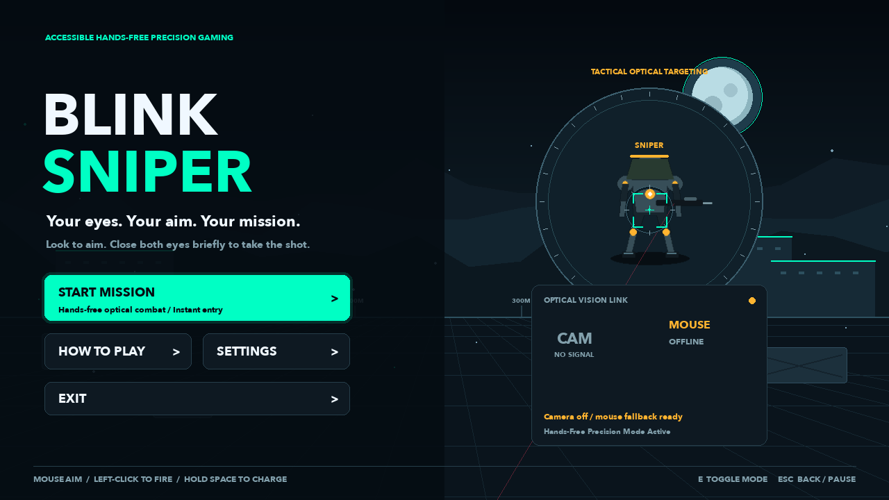
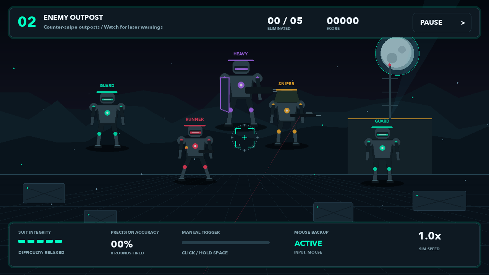

# BLINK SNIPER 🎯👁️

An accessible, hands-free tactical sniper game built with Python, Pygame, and MediaPipe. Designed specifically for players without upper-limb mobility: **aim with your gaze and head motion, close both eyes to fire.**



## Key Features

- **Hands-Free Optical Gameplay:** Seamless gaze and head-pose targeting with gentle magnetic target acquisition.
- **Dual Neural & Geometric Blink Detection:** Powered by MediaPipe Neural Blendshapes (`eyeBlinkLeft` + `eyeBlinkRight`) fused with Bilateral Eye Aspect Ratio (EAR) for rock-solid, responsive blink recognition without false winks.
- **Zero-Dependency Procedural Audio:** Fully synthesized high-impact tactical audio in pure Python/Pygame (sniper gunshot boom, railgun charge whine, hit markers, headshot chimes, alarms, and blink confirmation tones).
- **Premium Cyberpunk Art Direction:** Articulated cyber-warriors with dynamic walking strides, rotating holographic drone targets, active enemy sniper laser targeting beams, purple forcefield mechs, screen recoil shake, and supersonic tracer effects.
- **Headshot & Weak Point System:** Precision aiming rewarded with critical headshot popups and double damage.
- **Three Tactical Missions:** From holographic firing range calibration to hostile outposts and civilian hostage rescue with a battle-mech boss.
- **Accessible Scanning Menus:** Automatic button scanning with dwell-selection and blink-activation.



## Quick Start

### 1. Requirements

- Python 3.10+
- Webcam (or optional mouse/keyboard fallback)

### 2. Installation

```sh
# Clone repository
git clone https://github.com/Zakariashakib/blink-sniper.git
cd blink-sniper

# Create and activate virtual environment
python3 -m venv .venv
source .venv/bin/activate   # On Windows: .venv\Scripts\activate

# Install dependencies
pip install -r requirements.txt

# Run the game
python main.py
```

*Note: `python "BLINK SNIPER.py"` also launches the complete game.*

### 3. Controls

| Action | Hands-Free (Webcam) | Keyboard / Mouse Fallback |
|---|---|---|
| **Aim** | Look toward target (head & eye tracking) | Move mouse |
| **Shoot** | Close both eyes (~140 ms) | Left Click |
| **Charged Shot** | Automatic power shot on sustained hold | Hold Space (750 ms) & release |
| **Menu Selection** | Blink when button is highlighted | Click or Press Enter |
| **Pause** | Gaze at PAUSE for 1.3 seconds | Press Esc |
| **Toggle Controls** | Press `E` | Press `E` |

### 4. Command-Line Options

```sh
# Launch in mouse mode without accessing the camera
python main.py --no-camera

# Use an external webcam device
python main.py --camera 1

# Render headless preview screenshots
python main.py --preview previews
```

## Running Automated Tests

```sh
python -m unittest discover -s tests -v
```

All 25 unit tests verify blink state machines, cold-start calibration, hysteresis rejection, lost-face handling, aspect-correct eye geometry, and full mission completion.

## Architecture

```
BLINK SNIPER/
├── game.py         # Main game loop, missions, combat mechanics, HUD
├── tracking.py     # MediaPipe FaceLandmarker, blendshape extractor, blink detector
├── visuals.py      # Procedural cyberpunk graphics, enemy models, optic reticle
├── audio.py        # Zero-dependency procedural sound synthesizer
├── main.py         # Primary launcher
├── BLINK SNIPER.py # Compatibility launcher
├── assets/         # MediaPipe Face Landmarker model asset
├── previews/       # Real-time rendered screenshots
└── tests/          # Comprehensive unit test suite
```

## License

MIT License. Designed and built with love for accessible gaming.
